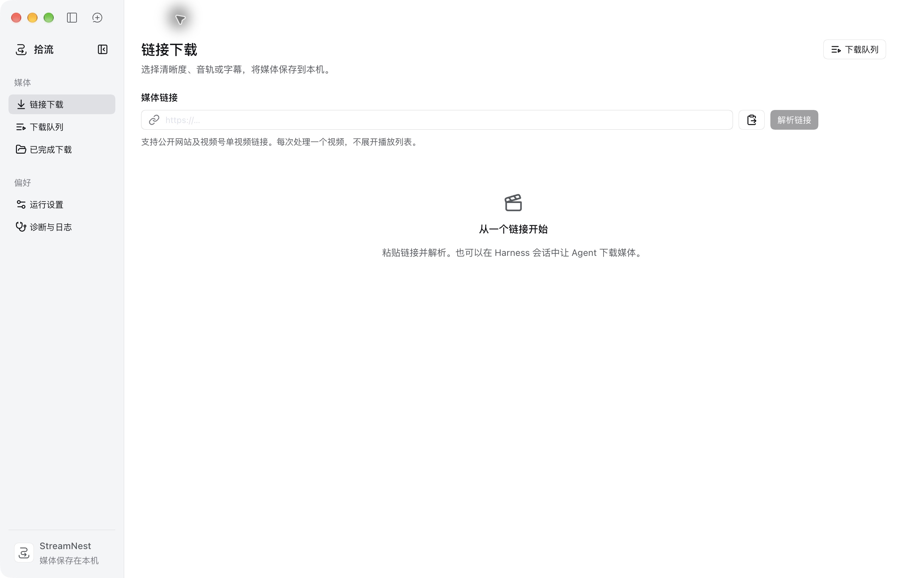

# 拾流 · StreamNest

[](https://github.com/deepseek-ai/deepseek-harness)
[](https://git.aimz.cc.cd/lynn1286/dsh-plugin-streamnest/stars)
[](package.json)
[](LICENSE)

中文 | [English](README.en.md)

解析音视频链接，选择画质、音轨或字幕并保存到本机。页面与 Agent 共用服务和下载队列。



## 功能

- 通过 yt-dlp 解析媒体；抖音、快手提供专用 API 和浏览器回退，支持微信视频号单视频分享链接。
- 选择画质和音轨、提取 MP3、下载原格式或 SRT 字幕。
- 排队、并发下载、进度与速度显示、暂停、继续和重试；支持直链分块续传、HLS / DASH 分片并发及可选 aria2。
- 搜索已完成下载、显示本地缩略图、播放、打开目录和同步目录；支持二次确认后的单个与批量永久删除。
- 配置下载目录、文件名模板、默认画质、代理、明确指定的浏览器账号或 Cookie 文件；支持中英文界面。
- 探测或安装 yt-dlp、FFmpeg、ffprobe，查看脱敏日志并生成反馈草稿。

## 安装

适配 DeepSeek Harness Desktop `0.2.1-rc.2`。在「插件 → 添加插件」中输入 `dsh-plugin-streamnest`，选择 npm 官方源安装并启用，或使用 CLI：

```bash
dsh plugin --profile desktop add dsh-plugin-streamnest --registry=https://registry.npmjs.org/

# Web 版：在服务端执行
dsh plugin --profile web add dsh-plugin-streamnest --registry=https://registry.npmjs.org/
```

本地 `.tgz` 安装包也可在插件页选择安装，或运行：

```bash
dsh plugin --profile desktop add file:/absolute/path/dsh-plugin-streamnest-0.1.0.tgz
```

替换为安装包的实际路径和版本。安装或更新后重启应用 / Web 服务；安装时无需编译。宿主 SDK 兼容范围见 `package.json` 的 `peerDependencies`。

## 使用

1. 在宿主中打开「拾流」，进入「运行设置」，选择本机下载目录并检查运行依赖。
2. 在「链接下载」粘贴媒体链接，解析后选择画质、音轨或字幕，加入下载队列。
3. 在「下载队列」查看进度和控制任务，在「已完成下载」播放或打开文件目录。

在宿主会话中也可让 Agent 解析链接、创建下载、查询队列或暂停任务，结果与页面同步。

## 限制

- 每次解析一个视频，不展开播放列表；不支持正在直播的媒体。
- 网站可用性取决于站点接口、访问权限、登录状态和运行工具版本。
- 视频号普通分享链接需要腾讯元宝登录状态；已携带有效播放参数的链接可直接解析。仅处理单视频内容。
- 浏览器 Cookie 仅在明确配置来源后读取；未配置时以未登录状态访问。
- 宿主重启后不会自动继续下载，需手动继续。
- 「已完成下载」中的删除会永久删除所选记录登记的文件，二次确认后执行，无法撤销；目录同步只整理记录，不删除文件。
- aria2 为可选工具，需自行安装或指定路径。

## 开发与发布

要求 Node.js ≥ 22.13、pnpm 11.5.0。

```bash
pnpm install --frozen-lockfile
pnpm verify                            # 格式、Lint、类型、构建和测试
pnpm pack --pack-destination artifacts  # 校验、构建并生成本地安装包
pnpm release --dry-run                  # 校验并预览 npm 包
pnpm release                           # 登录 npm 后校验、构建并发布
```

`verify` 依次执行 `check → build → test`，打包和发布由 `prepack` 自动执行同一验证。本地安装包输出至 `artifacts/dsh-plugin-streamnest-<版本>.tgz`。

`release` 依次执行 npm 浏览器登录、`whoami` 身份校验，再发布到 npm 官方源（public / latest）；任一步失败立即停止。`--dry-run` 仅校验和预览包内容，不登录、不上传、不写入安装包。再次发布前更新 `package.json` 的 `version`，已发布版本不能覆盖。

npm 包仅包含编译后的 JavaScript、运行配置、语言文件、必要资产、说明文档及许可和来源清单；不包含 TypeScript / TSX 源码、source map、测试或构建脚本。

本地预览运行 `pnpm dev`：页面为 `http://127.0.0.1:5179`，API 为 `http://127.0.0.1:4322/streamnest/api`。预览使用官方主题与控件，Desktop 继承宿主主题。

| 目录                             | 职责                                      |
| -------------------------------- | ----------------------------------------- |
| `apps/api`                       | NestJS 业务服务、DTO 校验、解析与下载实现 |
| `apps/web`                       | React 页面与中英文词库                    |
| `apps/shared`                    | 任务、设置、输出文件等共享契约            |
| `packages/harness`               | 宿主接入、官方 UI 适配与 Agent 工具       |
| `assets/reference-projects.json` | 参考项目来源清单                          |
| `licenses`                       | 参考项目原始许可文本                      |

## 感谢开源

参考实现：[DownVid](https://github.com/yxxbc/downvid) · [wx_channels_download](https://github.com/ltaoo/wx_channels_download)

## 许可

原创部分采用 [MIT 许可](LICENSE)，顶部 MIT 徽章仅指原创部分。参考及改编部分保留各自原作者版权和许可，wx_channels_download 的许可包含 Commons Clause 附加条款，以许可原文为准。构建时将参考项目来源、原始许可和客户端依赖许可汇总至 `lib/THIRD_PARTY_LICENSES.txt`。

## 免责声明

- 本项目为独立开发的第三方插件，与 DeepSeek 及相关媒体平台不存在官方隶属或背书关系。
- 仅下载自己拥有权利、已获得授权或适用法律允许下载的内容，并遵守来源平台的服务条款及版权、隐私等要求。不得用于绕过付费、DRM 或其他访问控制，不得用于未经授权的传播或其他违法用途。
- 软件按「现状」提供，不保证第三方站点持续可用，也不保证下载结果完整、准确或适合特定用途。请自行保管账号凭据并备份重要文件；在适用法律允许的范围内，作者及贡献者不对使用本软件造成的损失承担责任，具体以 [LICENSE](LICENSE) 及相关第三方许可为准。
